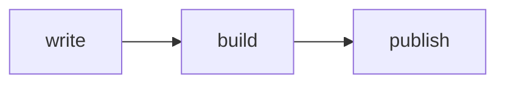

# hrabal

A small static site generator, heavily inspired by [Zola](https://www.getzola.org/).
Markdown in, HTML out, Jinja templates in between.

Named after Bohumil Hrabal, who knew a thing or two about pressing a lot of paper into neat bales.

## Getting started

Needs Python 3.14.

```sh
uv tool install .
hrabal init site
cd site
hrabal serve
```

Open http://127.0.0.1:1111/ and start editing. The browser reloads after every change.
When you're happy, `hrabal build` writes the finished site into `public/`.

## How a site looks

```
site/
├── config.toml
├── content/
│   ├── _index.md            -> /
│   ├── about.md             -> /about/
│   └── blog/
│       ├── _index.md        -> /blog/
│       ├── first-post.md    -> /blog/first-post/
│       └── with-pictures/
│           ├── index.md     -> /blog/with-pictures/
│           └── photo.jpg    -> /blog/with-pictures/photo.jpg
├── templates/
└── static/                  copied to the output as is
```

Every folder in `content/` is a **section** and every other Markdown file is a **page**.
`_index.md` is optional and only there to give the section a title and settings.
A page can also be a folder with `index.md` inside, then the rest of the folder is copied along with it.
A folder can't have both, it's either a section or a page. Files starting with a dot are skipped.

A date at the start of a file name becomes the page's date: `2024-05-01_hello.md` (or `2024-05-01-hello.md`)
lives at `/hello/` and is dated May 1st, unless the front matter says otherwise. Works for page folders too.

## Front matter

TOML between `+++` lines, like in Zola:

```toml
+++
title = "Příliš hlučná samota"
date = 2024-05-01
updated = 2024-08-02       # last edited, see below
description = "Shown in the meta tag"
slug = "custom-url"        # default is the file name
draft = true               # left out unless you pass --drafts
weight = 10                # for sort_by = "weight"
template = "special.html"

[taxonomies]
tags = ["books"]

[extra]
anything = "you like"
+++
```

Sections take `title`, `description`, `sort_by` (`date`, `title`, `weight` or `none`),
`weight`, `draft`, `template`, `page_template`, `paginate_by`, `paginate_path`, `paginate_reversed`
and `extra`.

A draft section takes everything inside it along, subsections included.
`page_template` applies to the subsections too, unless one of them sets its own.

Unknown keys are an error. That's on purpose, so typos don't go unnoticed.

`updated` says when a page was last edited. Without it, hrabal takes the date the file was last
modified. Keep in mind that a fresh clone, in CI for example, gives every file the time of the clone,
so for a site built that way, `updated` in the front matter is what keeps the dates honest.
The sitemap's `lastmod` and Atom's `<updated>` use the later of `date` and `updated`, which templates
get as `page.last_changed()`. The starter prints "Last edited" under a post that changed after its date.

Put `<!-- more -->` in a page to mark where its summary ends.

## Footnotes

```markdown
Hrabal pressed paper for thirty-five years.[^years]

[^years]: In the novel, at least.
```

The reference becomes a small number linking down to the note, and the notes gather at the end of the
page, each with a link back up. Numbers follow the order the notes are first used, the names are only
for you. A reference without a note stays plain text, and summaries leave the numbers out, since their
notes are usually below `<!-- more -->`. It's the footnote plugin from `mdit-py-plugins`, with
GitHub-like markup: `sup.footnote-ref`, `section.footnotes` and `a.footnote-backref`.

## Heading anchors

Every heading gets an id from its text, like in Zola: `## Quotes and alerts` becomes
`<h2 id="quotes-and-alerts">`, Czech letters lose their accents the same way urls do, and a second
heading with the same text gets `-1`, `-2` and so on. A page's ids are in `page.heading_ids`.

`insert_anchor_links` in `config.toml` adds a link to each heading too: `"none"` (the default),
`"left"` or `"right"` for a small `#` next to it, or `"heading"` to make the whole heading the link.
The links have the class `anchor`, the starter shows its `#` only on hover.

Links to a heading are checked like the rest: `[tables](@/blog/tour/index.md#tables)` stops the build
when the tour has no heading that becomes `tables`.

## Alerts

Note, tip and warning boxes are written the way GitHub does it, as a blockquote with a marker:

```markdown
> [!WARNING]
> Back up the site before upgrading.

> [!TIP] Faster builds
> A title of your own can follow the marker.
```

The markers are `[!NOTE]`, `[!TIP]`, `[!IMPORTANT]`, `[!WARNING]` and `[!CAUTION]`. Without a title of
its own an alert gets one in the site's `language`, English or Czech ("Poznámka", "Varování", …).
The HTML is GitHub's too, `<div class="markdown-alert markdown-alert-warning">` with a
`<p class="markdown-alert-title">`, so CSS made for GitHub alerts works. The starter has its own.

## Links

Link to other content by its file path: `[read this](@/blog/first-post.md)`.
Files that live in a page folder work the same way, in links and images:
``.
Links get checked during the build, so a broken one stops it.

## Diagrams

Code blocks marked `mermaid` become [Mermaid](https://mermaid.js.org/) diagrams:

````markdown

````

hrabal leaves their source as it is, in a `<pre class="mermaid">`, and the browser draws them.
Pages and sections with a diagram have `has_mermaid` set, so a template can load Mermaid only there.
The starter does that with `static/mermaid.js`, which also redraws the diagrams when the theme switches.
It loads Mermaid from jsDelivr, pinned to one version, change the version there to upgrade.

## Sitemap

Every build writes `sitemap.xml` with every page it rendered: sections and each of their pagers,
pages, taxonomy lists and terms. The `page/1/` redirects are left out, drafts are in only when
they're built, and pages with a date get it as `<lastmod>`.

To change how it looks, put your own `templates/sitemap.xml` in the site. It gets `entries`,
each with a `permalink` and a `date` (or nothing). `generate_sitemap = false` in `config.toml`
turns it off.

## robots.txt

Every build also writes a `robots.txt` that lets every crawler in and tells them where the sitemap is:

```
User-agent: *
Allow: /
Sitemap: https://example.com/sitemap.xml
```

The `Sitemap` line is left out when there's no sitemap. A site's own `templates/robots.txt` replaces it,
to keep some crawler or folder out, and it gets `config` and `get_url` like every template.
`generate_robots_txt = false` turns it off. Crawlers only read `robots.txt` at the root of a domain,
so for a site under a path like `example.com/blog/` it's of no use.

## Feeds

Atom by default, RSS if you like, or both:

```toml
author = "Your Name"                        # goes into the Atom feed
generate_feeds = true                       # /atom.xml with every page that has a date
feed_filenames = ["atom.xml", "rss.xml"]   # default is just atom.xml
feed_limit = 20                             # newest 20 only, 0 (the default) means all
taxonomies = [{ name = "tags", feed = true }]   # /tags/books/atom.xml for every term
```

A section can have its own feed too, with `generate_feeds = true` in its `_index.md`.
Feeds hold only pages with a date, newest first, and skip drafts unless they're built.
Dates in feeds are always in English and UTC, whatever the site's `language` is, because feed readers expect that.

The feeds come from built-in `atom.xml` and `rss.xml` templates. A site can replace either with its
own in `templates/`, or add another name to `feed_filenames` with a template to match. They get
`pages`, `title`, `link` (the page the feed belongs to), `feed_url`, `last_updated` and, for section
and term feeds, `section` or `taxonomy` and `term`. Two filters help with dates there:
`{{ page.date | rfc3339 }}` for Atom and `{{ page.date | rfc822 }}` for RSS.

## Search

With `build_search_index = true`, every build writes `search_index.json`, one entry per page:

```json
{"title": "…", "url": "…", "date": "2024-05-01", "description": "…", "tags": ["books"], "text": "…"}
```

`text` is the page without its HTML, scripts or diagram source, cut at 5000 characters.
`search = false` in a page's front matter keeps it out, drafts are in only when they're built.

hrabal only writes the index, the searching happens in the browser, in the starter's `static/search.js`.
It fetches the index on the first keystroke, ignores case and diacritics (`zlutoucky kun` finds
"Žluťoučký kůň"), wants every word to match the start of a word, and ranks title above tags above text.

In the starter, the magnifying glass in the header opens search in an overlay, and so do `/` and
Ctrl/⌘+K. Esc or a click outside closes it. Without JavaScript the same icon just goes to the search
page (`content/search.md` with the `search.html` template), which also keeps the query in the url:
`/search/?q=hrabal` opens with results.

## Pagination

Works like in Zola. Set `paginate_by` in a section's `_index.md` and its pages get split into pagers
of that size: the first one at the section's own url, the others at `page/2/`, `page/3/` and so on.
`page/1/` just redirects to the first one.

```toml
+++
title = "Blog"
paginate_by = 10
paginate_path = "strana"   # /blog/strana/2/ instead of /blog/page/2/, "" gives /blog/2/
paginate_reversed = true   # oldest first, if the section sorts newest first
+++
```

Taxonomy terms can be paginated too, write the taxonomy as a table in `config.toml`:

```toml
taxonomies = ["tags", { name = "categories", paginate_by = 5 }]
```

The template then gets a `paginator` with `pages` (the ones on this pager), `current_index` (from 1),
`number_pagers`, `paginate_by`, `total_pages`, `first`, `last`, `previous` and `next` (urls, or
nothing at the ends) and `base_url`, so `paginator.base_url ~ 3 ~ "/"` links to the third pager.
Without `paginate_by` there's no `paginator` at all, and `section.pages` always holds every page.

## Templates

| Template                    | Used for                    | Variables                       |
|-----------------------------|-----------------------------|---------------------------------|
| `index.html`                | the root section            | `section`, `paginator`          |
| `section.html`              | every other section         | `section`, `paginator`          |
| `page.html`                 | pages                       | `page`                          |
| `taxonomy/list.html`        | `/tags/`                    | `taxonomy`                      |
| `taxonomy/single.html`      | `/tags/books/`              | `taxonomy`, `term`, `paginator` |

`tags/list.html` and `tags/single.html` take precedence if a taxonomy needs its own look.

Everywhere you also get `config` and these functions:

- `get_url("style.css")` or `get_url("@/about.md")`
- `get_page("blog/first-post.md")`
- `get_section("blog/_index.md")`
- `get_taxonomy_url("tags", "books")`
- `now()`, the time of the build, so `{{ now().year }}` keeps a copyright line current

and a `date` filter, with the usual `strftime` codes: `{{ page.date | date("%d. %m. %Y") }}`.

Month and day names follow `language` in `config.toml`, English and Czech are built in.
A template can ask for another one with `locale`:

```jinja
{{ page.date | date("%-d. %B %Y", locale="cs") }}   {# 1. května 2024 #}
{{ page.date | date("%OB %Y", locale="cs") }}       {# květen 2024, the month on its own #}
{{ page.date | date("%A %-d. %-m.", locale="cs") }} {# středa 1. 5. #}
```

`%B` is the month as it's used inside a date ("1. května"), `%OB` the plain one ("květen").
A minus, like in `%-d`, drops the leading zero. `cs_CZ` works as well as `cs`.

Pages have `title`, `description`, `content`, `summary`, `date`, `permalink`, `path`, `slug`,
`taxonomies`, `assets`, `extra`, `previous` and `next` (neighbours in the section's order).
Sections have `title`, `description`, `content`, `pages`, `subsections`, `permalink`, `path` and `extra`.
`draft` only decides whether something gets built, templates don't see it.

## Development

Development happens in Docker, with the source mounted into the container, so edits show up right away.
Tooling is [uv](https://docs.astral.sh/uv/), [ruff](https://docs.astral.sh/ruff/) and [ty](https://docs.astral.sh/ty/).

Once, tell compose who you are, so files made in the container belong to you and not to root:

```sh
printf 'UID=%s\nGID=%s\n' "$(id -u)" "$(id -g)" > .env
docker compose build
```

Then:

```sh
docker compose run --rm dev pytest
docker compose run --rm dev ruff format
docker compose run --rm dev ruff check
docker compose run --rm dev ty check
docker compose run --rm js              # the starter's JavaScript, with node's test runner
```

Most tests run against `tests/test_site/`, a small site in the spirit of Zola's own test site.
Its templates print plain `Label: value` lines, so a test can check exactly what a template got.
When you add a feature, give it some content there and a line in a template, then assert on the output.
It's a normal site, so you can also look at it in the browser:

```sh
docker compose run --rm --service-ports dev hrabal -r tests/test_site serve -i 0.0.0.0
```

To try the dev server, `--service-ports` publishes port 1111 and `-i 0.0.0.0` makes hrabal listen
outside the container:

```sh
docker compose run --rm dev hrabal init site
docker compose run --rm --service-ports dev hrabal -r site serve -i 0.0.0.0
```

That's reachable only from the machine running Docker. If it's a remote VM and you want to open the site
from your laptop, add `PUBLISH_ADDRESS=0.0.0.0` to `.env` and tell hrabal the address you'll use,
so the links point there and not to localhost:

```sh
docker compose run --rm --service-ports dev hrabal -r site serve -i 0.0.0.0 -u http://my-vm:1111
```

New dependencies go through uv in the container, then rebuild the image:

```sh
docker compose run --rm dev uv add some-package
docker compose build
```

The lockfile points at public PyPI on purpose, see `[[tool.uv.index]]` in `pyproject.toml`.
