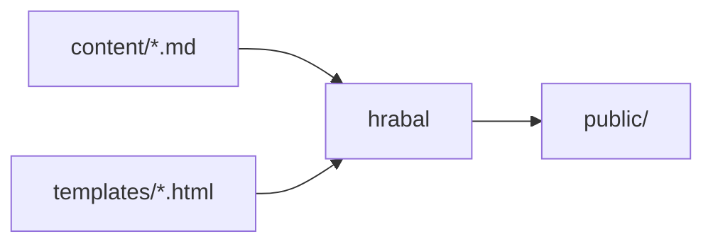

+++
title = "About"
+++

Pages next to `_index.md` belong to the root section, so this one lives at `/about/`.

Links between pages use the file path, like [the first post](@/blog/prilis-hlucna-samota.md).
A broken link stops the build, so they can't quietly rot.

Diagrams are written in [Mermaid](https://mermaid.js.org/) and drawn in the browser:

